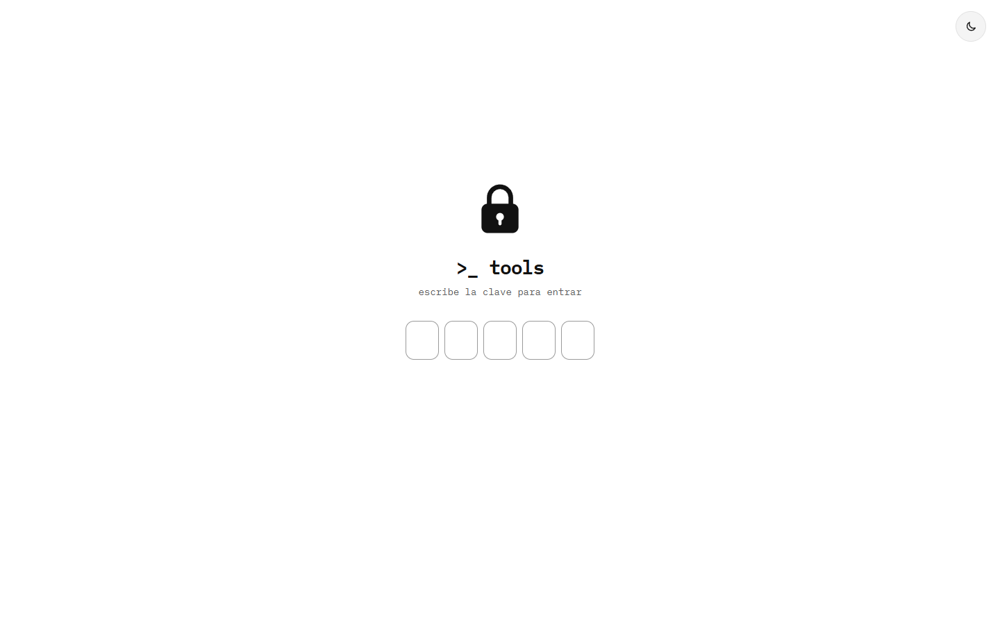
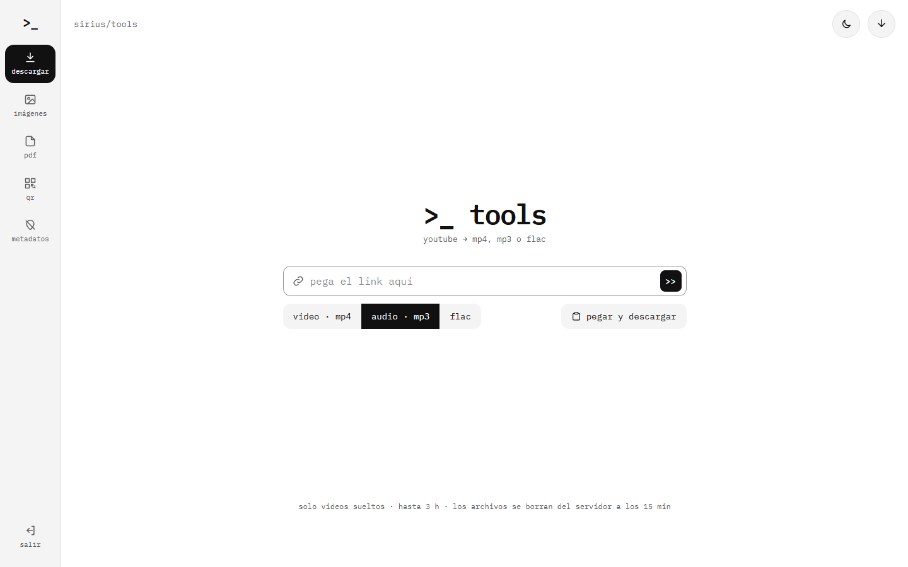

# Sirius Tools

Suite web personal de herramientas (descargador de YouTube, imágenes, PDF, QR y metadatos) para no depender de sitios de terceros.


[Sitio](https://tools.iamsirius.cl)

<p align="center">
  
  
</p>

## Tabla de contenidos

- [Descripción](#descripción)
- [Estado del proyecto](#estado-del-proyecto)
- [Características](#características)
- [Tecnologías](#tecnologías)
- [Requisitos](#requisitos)
- [Instalación](#instalación)
- [Uso](#uso)
- [Seguridad](#seguridad)
- [Privacidad y rendimiento](#privacidad-y-rendimiento)
- [Estructura del proyecto](#estructura-del-proyecto)
- [Licencia](#licencia)
- [Autor](#autor)

## Descripción

Sirius Tools reúne en un solo sitio las herramientas que suelen usarse en páginas de terceros llenas de publicidad o de dudosa privacidad. Todo el sitio está detrás de una clave compartida de 5 caracteres. Solo el descargador de YouTube corre en el servidor (`yt-dlp` + `ffmpeg`); el resto se ejecuta en el navegador, así que esos archivos nunca salen del equipo.

## Estado del proyecto

**Activo.** Primera versión publicada en octubre de 2026 y en desarrollo.

## Características

| Ruta | Herramienta | Dónde corre |
|---|---|---|
| `/` → `/youtube` | Descargar audio (MP3, FLAC) o video (MP4) de YouTube, con cola de descargas | Servidor (`yt-dlp` + `ffmpeg`) |
| `/imagenes` | Recortar, redimensionar, convertir y comprimir | Navegador |
| `/pdf` | Unir, extraer y reordenar páginas | Navegador (`pdf-lib`) |
| `/qr` | Generar códigos QR (PNG y SVG) | Navegador (`qrcode`) |
| `/metadatos` | Quitar GPS, EXIF y XMP de fotos sin recomprimir | Navegador |

- Acceso con clave de 5 caracteres y sesión en cookie firmada; sin base de datos.
- Tema claro y oscuro.
- Tests de la lógica con Vitest (sesión, links de YouTube, páginas de PDF, metadatos, imágenes, IP, cola).

## Tecnologías

- [Astro](https://astro.build/) 7 con adaptador [Node](https://docs.astro.build/en/guides/integrations-guide/node/) (SSR)
- [TypeScript](https://www.typescriptlang.org/) 6 en modo estricto
- [Tailwind CSS](https://tailwindcss.com/) 4
- [pdf-lib](https://pdf-lib.js.org/) 1.17 y [qrcode](https://github.com/soldair/node-qrcode) 1.5
- [yt-dlp](https://github.com/yt-dlp/yt-dlp) y [FFmpeg](https://ffmpeg.org/) para las descargas
- [Vitest](https://vitest.dev/) 5
- Docker (Node 24 Alpine)

## Requisitos

- Node.js 24 o superior
- `yt-dlp` y `ffmpeg` en el PATH, solo para el descargador (en Windows: `winget install yt-dlp.yt-dlp`, que instala ambos)
- Docker y Docker Compose, opcional para producción

## Instalación

```bash
git clone https://github.com/ViceAguilera/SiriusTools.git
cd SiriusTools
npm install
cp .env.example .env
```

### Configuración

Completa el `.env` (ver `.env.example`):

```
TOOLS_PASSWORD=   # Clave de entrada: exactamente 5 caracteres. Cambiarla cierra todas las sesiones
SESSION_SECRET=   # Mínimo 32 caracteres
TRUST_PROXY=false # true solo detrás de Nginx (para leer la IP real en los límites por IP)
YTDLP_PATH=yt-dlp # Ejecutable de yt-dlp (en Docker ya viene instalado)
```

## Uso

```bash
npm run dev       # Servidor de desarrollo
npm test          # Tests de la lógica
npm run check     # Revisión de tipos
npm run build     # Build de producción (necesita las variables del .env)
```

### Docker

```bash
docker compose up -d --build
```

La aplicación queda en `127.0.0.1:9002`, solo accesible desde el propio servidor; en producción se publica detrás de Nginx. La imagen incluye `yt-dlp` y `ffmpeg`.

## Seguridad

- Todo el sitio va detrás de la clave (`src/middleware.ts`); las APIs responden 401 sin sesión.
- Máximo 5 intentos fallidos por IP cada 15 minutos, reforzado con una regla de Cloudflare.
- El descargador solo acepta videos de YouTube: rearma la URL a partir del ID, así `yt-dlp` no puede pedir otras direcciones (ni servicios internos del servidor). Máximo 2 descargas a la vez, 20 en cola, 30 por hora por IP, 3 h y 2 GB por video, y 10 GB guardados en total.
- CSP con hashes (`security.csp` de Astro, solo en build) y cabeceras de seguridad: `frame-ancestors 'none'`, `X-Frame-Options`, `nosniff`, `Referrer-Policy`, `Permissions-Policy` y COOP. Por la CSP no hay scripts inline: lo que deba correr antes de pintar va en `public/` (ver `theme-init.js`).
- Contenedor sin capacidades, con `no-new-privileges`, 1 GB de memoria y 200 procesos como tope.

## Privacidad y rendimiento

- Solo una cookie estrictamente necesaria (`tools_session`); el tema, la cola y el aviso visto viven en el navegador. Sin analítica ni terceros. Detalle en `/privacidad`.
- Las descargas viven en memoria y en `/tmp` hasta 15 minutos.
- Primera visita de una página: unos 85 KB sin comprimir. `pdf-lib` (~400 KB) se descarga recién al elegir el primer PDF.
- La fuente (IBM Plex Mono) se sirve desde el propio sitio y los archivos de `/_astro/` llevan hash para cachearse un año.

## Estructura del proyecto

```
src/
  pages/            # Herramientas (youtube, imagenes, pdf, qr, metadatos), entrar, privacidad y errores
  pages/api/yt/     # API de trabajos de descarga (crear, consultar estado, bajar archivo)
  lib/              # Lógica: sesión, auth, YouTube, cola, imágenes, PDF, metadatos, IP (con sus tests)
  components/       # Cola de descargas, aviso de cookies, selector de tema
  layouts/          # Layout común
  config/tools.ts   # Lista de herramientas del menú
  middleware.ts     # Control de acceso y cabeceras de seguridad
public/             # favicon, robots.txt y theme-init.js
docs/               # Capturas para el README
Dockerfile          # Build en dos etapas con yt-dlp y ffmpeg
docker-compose.yml  # Servicio endurecido en 127.0.0.1:9002
.env.example        # Plantilla de variables de entorno
```

## Licencia

Distribuido bajo la licencia MIT. Ver [LICENSE](LICENSE).

## Autor

**Vicente Aguilera Arias** — [Portafolio](https://portfolio.iamsirius.cl) · [GitHub](https://github.com/ViceAguilera) · [LinkedIn](https://www.linkedin.com/in/vicenteaguilera/)
